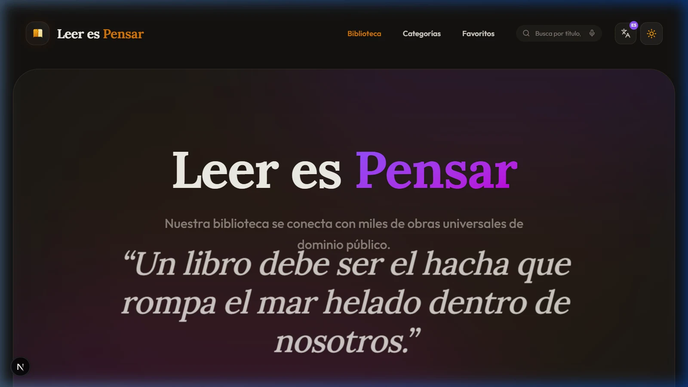

# 📖 Leer es Pensar — Biblioteca Digital Zen

<div align="center">
  <p align="center">
    <strong>Plataforma Web de Libros Clásicos de Dominio Público & Lector Inmersivo</strong>
  </p>

  <p align="center">
    <a href="https://frankusqabant.github.io/Proyecto-Library/">
      
    </a>
    
    
    
    
    
  </p>

  <br />

  <a href="https://frankusqabant.github.io/Proyecto-Library/">
    
  </a>

  <br><br>
</div>

---

## 📚 Sobre el Proyecto

**Leer es Pensar** es una biblioteca digital moderna y minimalista diseñada para los amantes de la lectura clásica y el pensamiento reflexivo. Permite explorar miles de obras maestras universales de dominio público, disfrutar de una experiencia de lectura zen sin distracciones y sincronizar favoritos en la nube.

> 🌐 **Sitio Web Oficial:** [https://frankusqabant.github.io/Proyecto-Library/](https://frankusqabant.github.io/Proyecto-Library/)

---

## ✨ Características Principales

- 🔍 **Catálogo Clásico Universal:** Integración con Gutendex y Open Library para acceder a miles de títulos de dominio público.
- 📖 **Lector Inmersivo Zen:** Tipografía refinada, sanitización estricta con DOMPurify y modo oscuro cálido.
- ⚡ **Base de Datos Turso (LibSQL):** Sincronización de favoritos y progreso en la nube con respaldo automático en `localStorage`.
- 🎙️ **Búsqueda por Voz y Filtros:** Búsqueda rápida por autor, título y categorías temáticas.
- 📱 **Diseño 100% Responsivo:** Interfaz fluida optimizada para móviles, tablets y monitores de escritorio.
- 🔒 **0 Vulnerabilidades:** Dependencias actualizadas y consultas SQL parametrizadas.

---

## 🛠️ Estructura del Repositorio

```
Proyecto-Library/
├── src/                  # 📁 Todo el código fuente englobado
│   ├── app/              # Rutas Next.js App Router (Inicio, Explorar, Categorías, Lector)
│   ├── components/       # Componentes de UI modulares
│   ├── hooks/            # Hooks personalizados
│   ├── lib/              # Utilidades, constantes y cliente de Turso DB
│   └── types/            # Definiciones de TypeScript
├── public/               # Recursos estáticos y capturas
├── .github/              # Workflow de despliegue a GitHub Pages
├── next.config.ts        # Configuración de Next.js
├── tailwind.config.js    # Configuración de estilos
├── tsconfig.json         # Configuración de TypeScript
└── package.json          # Dependencias y scripts
```

---

## 🚀 Instalación y Ejecución Local

```bash
# 1. Clonar el repositorio
git clone https://github.com/FrankUsqAbant/Proyecto-Library.git

# 2. Entrar a la carpeta
cd Proyecto-Library

# 3. Instalar dependencias
npm install --legacy-peer-deps

# 4. Iniciar servidor local
npm run dev
```

Abre tu navegador en: 👉 **[http://localhost:3000](http://localhost:3000)**

---

<div align="center">
  <sub>© 2026 Leer es Pensar · Diseñado & Desarrollado por <strong>Franquer Abanto</strong></sub>
</div>
